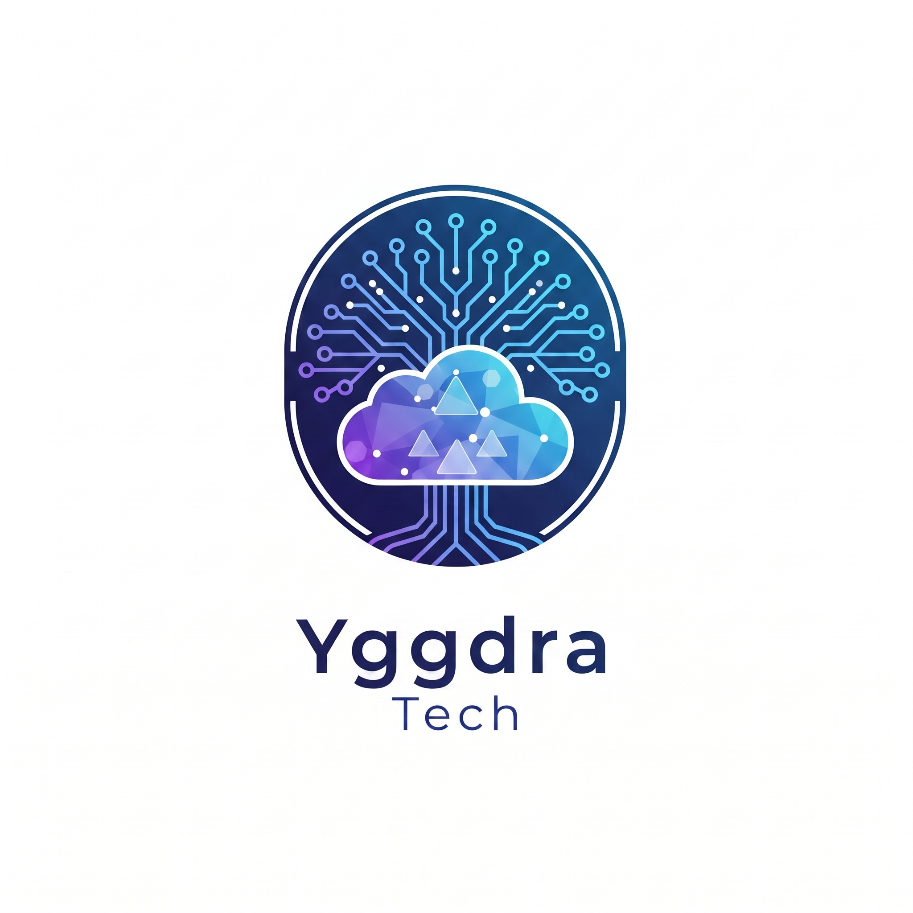

  

  

  
  
  

---

## 👋 Sobre mim

🇧🇷 **São Luís de Montes Belos, Goiás**  

🎓 Estudante de **Engenharia de Software.**  
🚀 Aprendendo sozinho, na prática | Desenvolvedor Full-Stack em formação.  
🧠 Focado em evolução e em transformar café (e tereré 🧉) em código de qualidade.

---

## 🚀 Projetos realizados

<table align="center">
  <tr>
    <td align="center" width="50%">
      <h3>🌐 Yggdra Tech</h3>
      
      
Site institucional da Yggdra, com foco em serviços de TI, suporte técnico e performance.

      
    </td>
    <td align="center" width="50%">
      <h3>🪽 Furinho Feliz</h3>
      
      
Site de agendamento para piercing corporal, com cadastro de clientes e identidade visual própria.

      
    </td>
  </tr>
</table>

---

## 🛠️ Projetos que venho trabalhando

- ☁️ **Yggdra Tech:** empreendendo em TI, com foco em suporte técnico, otimização de hardware e performance.
- 🎓 **Projetos acadêmicos:** sistemas web e gestão de banco de dados (**LabTech**).
- 🧱 **Front-end:** HTML e Bootstrap para interfaces responsivas.

---

## 🧰 Tech Stack

  

---

## 🎯 Meus objetivos

- 💼 Consolidar minha carreira como Desenvolvedor de Software.
- 🎓 No futuro, buscar um mestrado e expandir meus horizontes profissionais.
- 🧠 Sempre aprimorar minhas habilidades em lógica de programação e arquitetura de sistemas.

---

## 📱 Contatos

  
  

<i>"O sucesso é a soma de pequenos esforços repetidos dia após dia."</i>

  

